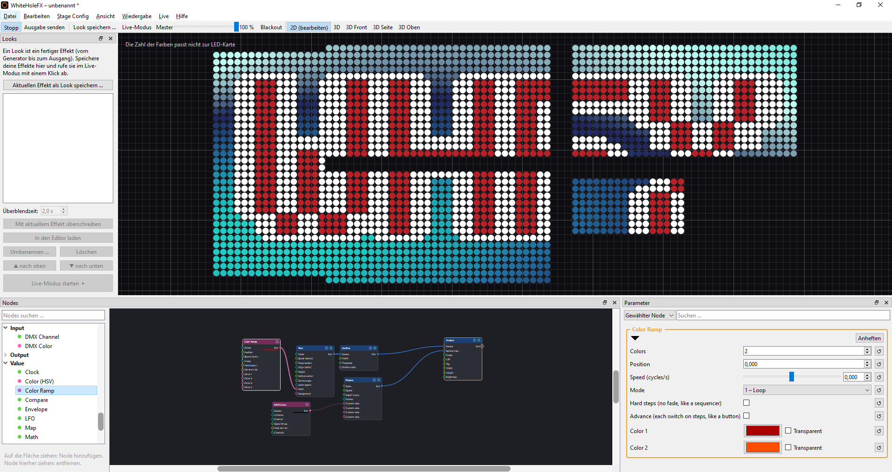

# WhiteHoleFX

Open-source real-time control for LED matrices, LED cubes, strips and pixel installations.
Effects are built as a node graph and run as shaders on the GPU. The same effects work for
flat matrices and for LEDs placed in 3D space.



> **Status: early, but usable.** Projects can be edited in a Qt interface (parameter sliders, node editor
> with node presets, layout editor, test mode, master/blackout, undo/redo), previewed live and sent as
> Art-Net, sACN or DDP; DMX from the network (Art-Net, sACN) can be read in through nodes; without the
> interface, `whitehole_cli` does the job. It builds and runs in CI on Linux and Windows (the GPU is only
> checked there with a software adapter). Building and installing (Linux .deb, Windows package):
> [BUILDING.md](BUILDING.md). See the [roadmap](#roadmap) and the [project file](docs/project-format.md).

> 🇩🇪 The German version of this page is [README.md](README.md).

## The idea in three sentences

An effect is a function from position and time to a colour. The compiler merges a whole node graph
into **one** shader function. The mapping says where each LED sits in space and samples the function
exactly there.

## Modules

| Module | Purpose |
|---|---|
| `wh_core` | Basic types, error handling without exceptions, service interfaces |
| `wh_gpu` | Abstract GPU interface, reader for shader bindings |
| `wh_gpu_webgpu` | Optional WebGPU backend (wgpu-native), runs in CI; see [GPU backend](docs/gpu-backend.md) |
| `wh_graph` | Graph model, node catalogue, parameters and modulation |
| `wh_values` | Evaluates CPU nodes (time, LFO, random, ...) once per frame |
| `wh_input` | DMX input: receives Art-Net and sACN, keeps the latest state per universe (for the DMX nodes) |
| `wh_audio` | Audio input: capture (miniaudio) or WAV file, FFT, 32-band spectrum, level, beat and tempo (for the audio nodes) |
| `wh_compiler` | Translates field nodes to WGSL |
| `wh_nodes` | Bundled nodes |
| `wh_engine` | Render loop, readback ring, stages |
| `wh_executor` | Runs the graph per frame: canvas texture and sampling at LED positions |
| `wh_mapping` | Fixtures (matrix, strip, 3D grid, point cloud), wiring, normalisation |
| `wh_output` | Colour conversion, patching onto universes, Art-Net / sACN / DDP, output thread, UDP |
| `wh_project` | Project file (text): read and write layout, effect graph, output |
| `wh_preview` | LED preview as an image (CPU) and PNG writer |
| `wh_runtime` | Session and player: assembles the project into running output, edits graph/layout/parameters, undo; check report |
| `apps/whitehole_studio` | Qt 6 interface: preview, parameters, node editor, layout editor, undo (optional, see [interface](docs/studio.md)) |
| `apps/whitehole_cli` | Console runner: `--check`, render and send |

Dependencies only point downwards. No module except `apps/whitehole_studio` knows about Qt.

## Building and testing

Short version (core without GPU and interface; CMake ≥ 3.25, GCC 13 / Clang 16 / MSVC 2022):

```bash
cmake --preset dev
cmake --build --preset dev --parallel
ctest --test-dir build/dev --output-on-failure
```

With GPU and interface, Windows and all the pitfalls: **[BUILDING.md](BUILDING.md)** (German).

## Documentation

- [Field nodes and compiler](docs/field-nodes.md)
- [Value graph (CPU nodes, modulation)](docs/value-graph.md)
- [Canvas stage](docs/canvas-stage.md)
- [Mapping and sampling pass](docs/mapping.md)
- [Output (Art-Net, sACN, DDP)](docs/output.md)
- [Changelog](CHANGELOG.md)
- [Project file and console runner](docs/project-format.md)
- [Building and starting](BUILDING.md)
- [Interface (Qt)](docs/studio.md)
- [Tutorial](docs/tutorial/en.md) ([Deutsch](docs/tutorial/de.md), [Français](docs/tutorial/fr.md), [Español](docs/tutorial/es.md), [Українська](docs/tutorial/uk.md))
- [Example projects](docs/examples.md)
- [Languages and translating](docs/translating.md)
- [Audio input (level, beat, spectrum)](docs/audio.md)
- [GPU backend (WebGPU)](docs/gpu-backend.md)

## Audio input

Audio nodes react to music: loudness, frequency bands, beat and tempo, plus an equaliser
("Spectrum Bars") as an effect. The source is a microphone or line input, or a WAV file on loop. The
input is **off** by default; switch it on in the Studio via *Input → Audio*, or with
`whitehole_cli project.whfx --audio-in default` (device) or `--audio-in music.wav`. The example
`examples/audio/audio.whfx` shows an equaliser with a pulsing background. Everything else:
[docs/audio.md](docs/audio.md) (German).

## Conventions

- C++20, no exceptions in the real-time path (`Result<T>`), no source file over about 400 lines.
- Coordinates: right-handed, x to the right, **y up**, z towards the viewer; colours are linear RGBA.
- Every source file starts with a comment that explains what it is for.

## Roadmap

- [x] 1–4: architecture, graph, compiler, value graph, GPU execution
- [x] 5: mapping and sampling pass
- [x] 6: output (Art-Net, sACN, DDP; WLED via DDP/Art-Net). Serial, TPM2.net, MQTT, Hyperion follow later; MIDI and OSC are postponed
- [x] DMX input via Art-Net and sACN (nodes "DMX Channel" and "DMX Color")
- [ ] 7: plugins and scripts
- [x] 8: interface (Qt 6): live preview, parameter sliders, node editor, layout editor, undo/redo; looks and live mode with crossfade; node palette with drag & drop
- [x] GPU backend runs in CI on software Vulkan (Linux) and a software adapter (Windows); checking on a real GPU is still pending
- [x] Project file and console runner (`whitehole_cli`)
- [x] Mapping import from CSV and JSON (point cloud)
- [ ] Mapping import from SVG, DXF and PNG
- [x] Audio input: level, frequency band, beat, tap tempo and spectrum bars (menu Input → Audio, `--audio-in`), see [Audio](docs/audio.md)
- [x] Effects: Lightning, Particles, Oscilloscope and Text/scrolling text (see [Field nodes](docs/field-nodes.md))
- [ ] Video sources
- [ ] Raster nodes (blur, feedback), Dawn backend

## Note on verification

CI builds and tests on Linux (GCC with ASan/UBSan, Clang) and Windows (MSVC) and runs the generated
shaders on a software Vulkan / software adapter; the interface is operated in an invisible window
(sliders, node editor, layout editor, undo). **Not yet tested** are operation on a real GPU, with real
controllers on the network, and operation with mouse and screen. Feedback on this is welcome.

## License

WhiteHoleFX is licensed under the [GNU General Public License Version 3 (GPL-3.0)](LICENSE) - an
open-source licence approved by the OSI.

**In short (not legal advice; the licence text is authoritative):**

- Free to use for **any purpose**: privately, in a club, as a DJ or lighting technician at paid events,
  in a company for your own installation - including commercially.
- You may change and redistribute it, including commercially. When you redistribute it (modified or
  unmodified), you must include the source code, and the result must also be licensed under GPL-3.0.
- **Not allowed:** distributing the software (even modified) as a closed-source product without shipping
  its source code.

Versions up to and including 0.21.0 were published under the Apache License 2.0; versions 0.22.0 to
0.92.0 under the PolyForm Shield License 1.0.0. For those versions the licence that applied at the time
remains in force (see the [changelog](CHANGELOG.md)). Notes on third-party libraries (wgpu-native, Qt,
Catch2) are in [NOTICE](NOTICE). Unless agreed otherwise, contributions are accepted under the same licence.
